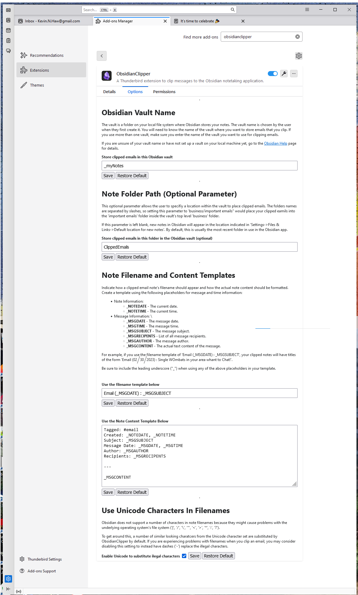
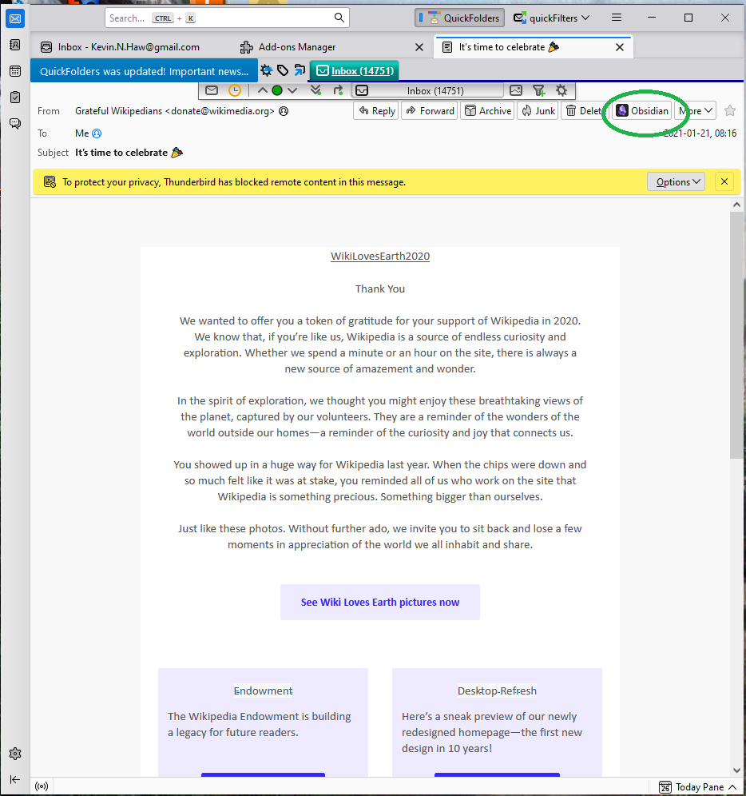
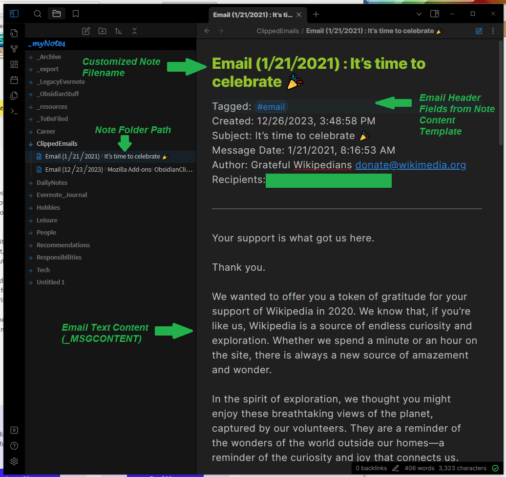

# ThunderbirdObsidianClipper
ObsidianClipper is an add-on for the Thunderbird email client that lets a user clip messages to the Obsidian notetaking application. Both applications are open source and free to use, just like this add-on!

In addition to the information below, there is a [User Guide](./docs/user-guide.md) giving detailed information on how to use the add-on.

## Installation
- You will first need to have the Obsidian notetaking app on your local platform as well as the Thunderbird email client.
  - You can download Thunderbird for free [here](https://www.thunderbird.net/en-US/download/).
  - You can download Obsidian for free [here](https://obsidian.md/download).
  - You can install the *Obsidian Clipper* add-on into Thunderbird in two ways:
    - By searching for "ObsdianClipper" in the Add-on mMnager (*Settings->Add-ons Manager*).
    - Or by downloading a file from the [Thunderbird Add-on Site](https://addons.thunderbird.net/en-US/thunderbird/addon/obsidianclipper/), clicking the "Download Now" button to get an XPI file, and installing that file from the add-on manager (*Add-on Manager->Settings->Install Add-on From File*).
- After installing ObsidianClipper to your Thunderbird client, select the Options tab (*Settings->Add-ons Manager->Obsidian Clipper->Options tab*) and configure the add-on to work with Obsidian on your machine.
  - *Obsidian Vault Name* - is the name of the vault you created to keep your notes in when you set up Obsidian.
  - *Note Folder Path* - an optional parameter that allows the user to specifiy a location within the
  vault to place clipped emails. By default, this will be the folder "ClippedEmails.". If this parameter is left blank, new notes in Obsidian will appear
  in the location indicated in 'Settings->Files & Links->Default location for new notes'.
  - *Note Filename and Content Templates* - allow you to specify how your clipped emails will be formatted and how the files will be named.

- After you've installed and configured the add-on, you're ready to clip emails!

## Usage
To use ObsidianClipper, just select an email and either right click it to find an "Obsidian" icon in the menu or open the email and look for the "Obsidian" icon on the header (where you will also find the Reply and Forward buttons). Press the "Obsidian" button and your Obsidian application will launch and load your vault and your email will be clipped into Obsidian. 

Once your email has been clipped, it will look like the screenshot below. By default, your note will be in the top level "ClippedEmails" folder (Obsidian will create the folder if needed), but you can change it with the *Note Folder Path* option mentioned above.

If you only wish to clip a portion of an email's text, select the text before pressing the Obsidian icon.

## Features and Limitations
Because Obsidian runs on its own dialect of the Markdown language, many features supported by email clients are available.
- Can clip HTML or text emails.
  - Supports most font effects (**bold**, _italics_, <s>strikethrough</s>) but not different fonts or variable font sizes.
- Clips attachments.

If you can think of a future feature, please post them at GitHub as described below in the **Feedback** section.

## Getting More Help
If ObsidianClipper is not properly working, please take a moment to reread the instructions and reinstall the add-on. If the problem is still happening, please check out the 
[Troubleshooting section of the User Guide](./docs/user-guide.md#Troubleshooting).

## Questions? Feedback?
ObsidianClipper is still a work in progress. If you have any questions or want to give me feedback, please reach out to to the team
by [filing an issue on GitHub](https://github.com/KNHaw/ThunderbirdObsidianClipper/issues), via the "Support Email" link on the
[Thunderbird add-on page](https://addons.thunderbird.net/en-US/thunderbird/addon/obsidianclipper/), 
or via the contact page on my personal website, [KevinHaw.com](http://www.kevinhaw.com).

If sending screenshots for a bug report or via email, make sure to blur or mark out any sensitive information since the images may be accessible to the wider internet.

I hope this add-on proves useful to you.
